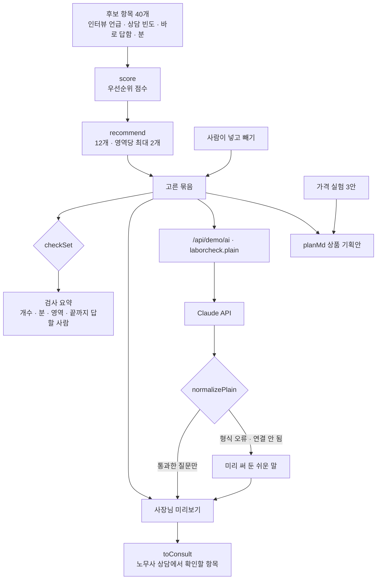

# 구조

## 12개를 고르는 규칙

`점수 = 인터뷰 언급 × 2 + 상담 빈도 × 3 + (바로 답할 수 있음 ? 2 : 0) − 답하는 데 드는 분 × 2`

1. 점수 순으로 정렬(같으면 원래 순서).
2. 한 영역에서 2개까지만 넣는다. 한 영역이 다 차지하면 진단표가 한쪽으로 쏠린다.
3. 영역 제한 때문에 12개를 못 채우면 남은 것 중 점수 순으로 채운다.

## 끝까지 답할 사장님 (추정)

인터뷰에서 사장님 9명에게 길이가 다른 진단표를 보여 준 결과(샘플): 12개 8명, 20개 4명, 40개 0명. 사이 값은 직선으로 잇습니다(`completion`).

## AI의 자리

- 고르기·검사·가격은 규칙과 사람이 합니다. AI는 고른 항목의 질문을 사장님 말로 다듬기만 합니다.
- 다듬은 질문에 위반·과태료·의무 같은 판단 표현이 있거나 질문형이 아니면 그 항목은 버리고 원래 말을 씁니다.
- 미리보기 결과는 판정이 아니라 ‘노무사 상담에서 확인할 항목’입니다.

## 파일

| 파일 | 하는 일 | DOM |
|---|---|---|
| `logic.js` | 후보 40개, 점수, 추천, 묶음 검사, 끝까지 답할 사람, 상담 목록, 가격, 응답 검사, 기획안 | 없음 |
| `ai-client.js` | `/api/demo/ai` 호출, 실패하면 `null` | 없음 |
| `app.js` | 후보 항목 · 검사 요약 · 미리보기 · 가격 실험 | 있음 |
| `tests/logic.test.js` | `node --test` 13개 | — |
