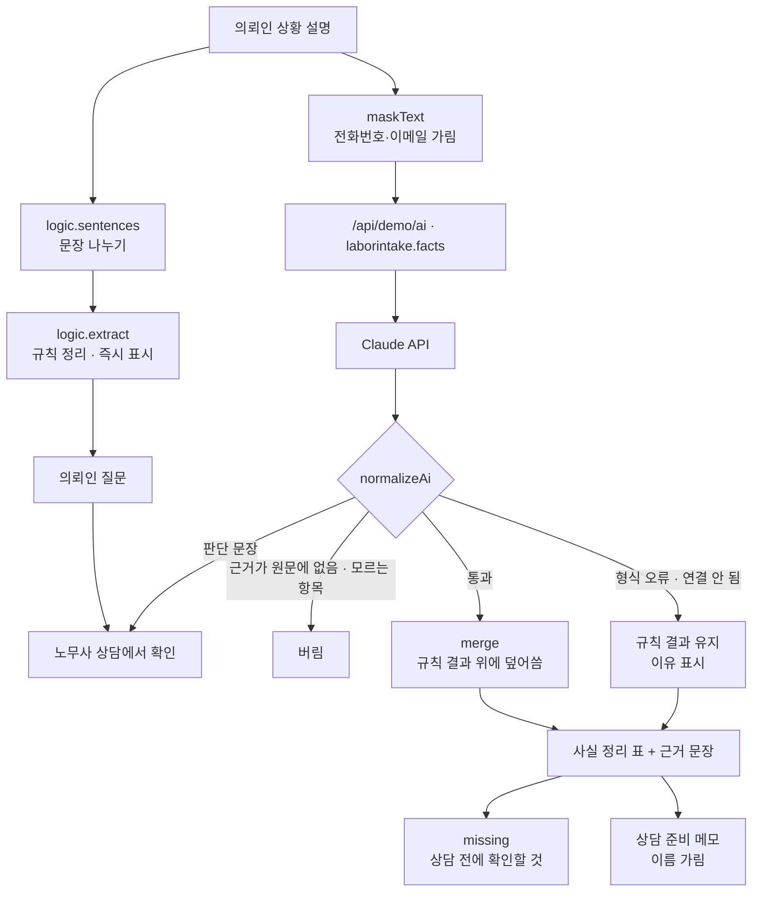

# 구조

## AI와 사람의 선

| 하는 일 | 누가 |
|---|---|
| 날짜·금액·근무 시간·계약서 유무를 옮겨 적기 | 규칙 / Claude |
| 근무 기간, 주 근무 시간 같은 단순 계산 | 규칙 |
| 받을 수 있는지, 위반인지, 무엇을 해야 하는지 | **노무사 (상담)** |

`isJudgement()`는 단정형 판단 표현(위법·불법·받을 수 있습니다·청구 가능·해당합니다·위반입니다 …)을 찾습니다. 의뢰인의 질문(…나요? …까요?)은 판단이 아니라 넘길 질문이라 걸리지 않습니다. Claude 응답의 `value`·`note`에 판단 문장이 있으면 그 값은 쓰지 않고 `blocked`에 담아 ‘노무사 상담에서 확인’ 칸에 줄을 그어 보여 줍니다. 응답의 `missing`은 참고만 하고, 화면의 확인 질문은 규칙(`missing()`)이 만듭니다.

## 근거 문장 확인 (`findQuote`)

Claude가 돌려준 `quote`를 두 글자씩 잘라 원문 문장들과 겹침을 잽니다. 0.5 미만이면 원문에 없는 근거로 보고 그 값을 버립니다(지어낸 사실 막기).

## 개인정보

- 연락처는 localStorage에 저장하지 않습니다. 주소창에도 아무것도 싣지 않습니다.
- 목록·메모·토스트에서는 이름을 가립니다(`maskName`). AI에는 이름·연락처를 보내지 않습니다.

## 파일

| 파일 | 하는 일 | DOM |
|---|---|---|
| `logic.js` | 문장 나누기, 날짜·금액·시간 읽기, 사실 추출, 판단 막기, 응답 검사, 가리기, 메모 | 없음 |
| `ai-client.js` | `/api/demo/ai` 호출, 실패하면 `null` | 없음 |
| `app.js` | 접수 목록 · 설명(고치기/문장 보기) · 사실 정리 · 판단 문장 검사 | 있음 |
| `tests/logic.test.js` | `node --test` 13개 | — |
