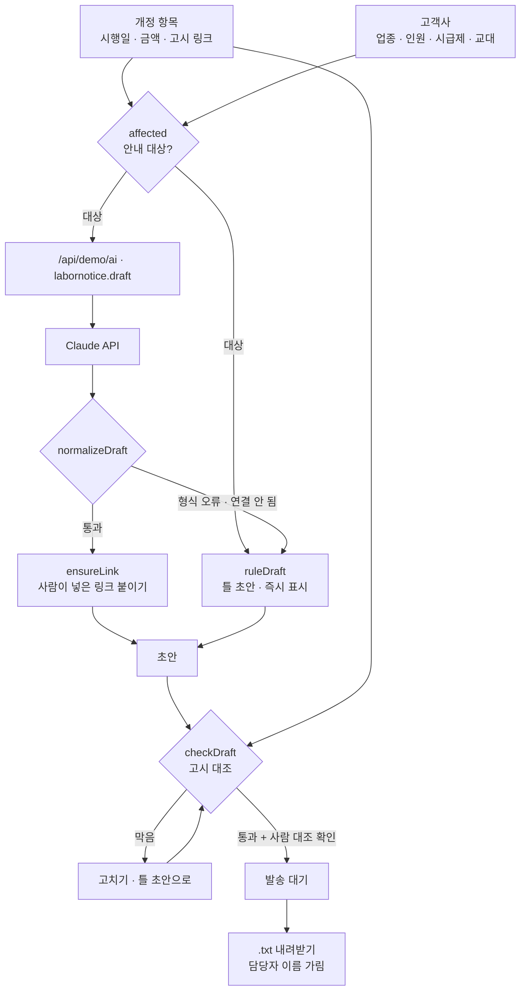

# 구조

## 대조 규칙 (`checkDraft`)

| 단계 | 내용 | 결과 |
|---|---|---|
| 날짜 | 제목·본문의 모든 날짜(2027년 1월 1일 / 2027-01-01 / 2027. 1. 1.)가 고시 시행일과 같은가 | 다르면 `막음` |
| 시행일 | 시행일이 한 번이라도 적혀 있는가 | 없으면 `막음` |
| 금액 | 본문의 원 금액이 고시 정보(변경 전·후) 안에 있는가 | 아니면 `막음` |
| 링크 | https 주소이고 본문에 그대로 있는가 / .go.kr 인가 | 없으면 `막음`, 정부 도메인 아니면 `확인`, 샘플이면 `참고` |
| 표현 | “위반입니다·과태료가 부과됩니다” 같은 단정 표현 | `확인` (노무사가 직접 검토) |
| 사람 | ‘고시 원문과 대조했어요’ | 없으면 발송 대기 불가 |

AI가 링크를 빼먹으면 `ensureLink()`가 사람이 넣은 링크를 붙입니다. 링크는 AI가 만든 것을 쓰지 않습니다.

## 파일

| 파일 | 하는 일 | DOM |
|---|---|---|
| `logic.js` | 날짜·금액 찾기, 링크 검사, 안내 대상, 틀 초안, 응답 검사, 고시 대조, 진행 현황, 내보내기 | 없음 |
| `ai-client.js` | `/api/demo/ai` 호출, 실패하면 `null` | 없음 |
| `app.js` | 개정 항목 · 고시 정보 · 고객사 · 초안 · 발송 대기 | 있음 |
| `tests/logic.test.js` | `node --test` 13개 | — |
