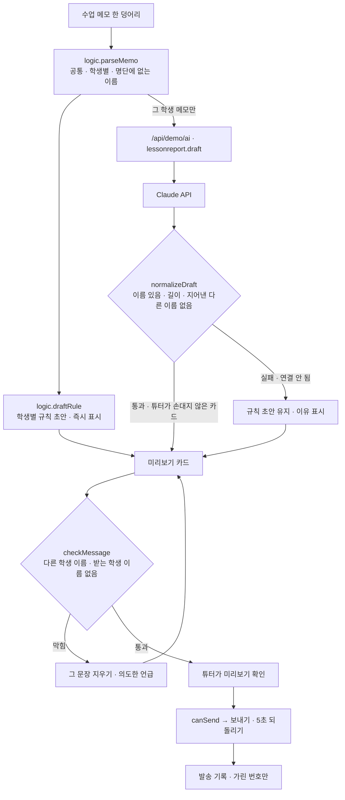

# 구조

## 보내기 전 확인 단계 (이 서비스의 핵심)

| 검사 | 막나? | 풀리는 법 |
|---|---|---|
| 명단의 다른 학생 이름이 들어 있다 (`other`) | 막음 | 그 문장 지우기, 또는 ‘의도한 언급이에요’ (그 이름만) |
| 받는 학생 이름이 없다 (`noself`) | 막음 | 고치기 |
| 내용이 비었다 (`empty`) | 막음 | 고치기 |
| 이 학생 메모가 없다 (`nomemo`) | 알림만 | — |
| 튜터가 ‘미리보기 확인’을 누르지 않았다 | 막음 | 확인 (막는 문제가 있으면 확인 칸이 꺼져 있음) |
| 확인한 뒤 내용을 고쳤다 | 확인이 풀림 | 다시 확인 |

AI에는 처음부터 **그 학생 메모만** 보내서 섞일 여지를 줄이고, AI가 메모에 없던 다른 학생 이름을 쓰면 응답을 버립니다. 그래도 메모 자체에 다른 학생이 나올 수 있어서(짝 활동 등) 검사는 늘 합니다.

## 파일

| 파일 | 하는 일 | DOM |
|---|---|---|
| `logic.js` | 메모 나누기, 규칙 초안, 보내기 전 검사, 진행 상황, 응답 검사, 번호 가리기, 발송 기록 | 없음 |
| `ai-client.js` | `/api/demo/ai` 호출, 실패하면 `null` | 없음 |
| `app.js` | 메모 · 받는 사람, 미리보기 카드, 보내기, 발송 기록 | 있음 |
| `tests/logic.test.js` | `node --test` 12개 | — |
