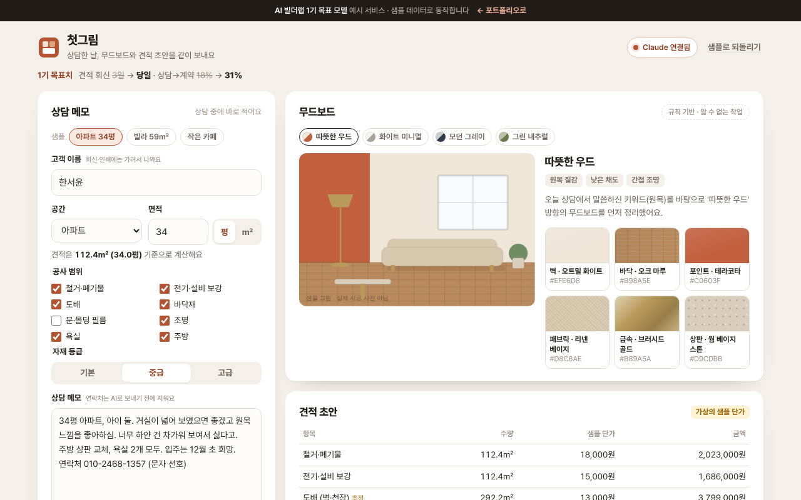

# 첫그림

> 첫 상담 자리에서 메모와 면적을 넣으면 **무드보드(색·재질 견본)와 견적 초안, 고객 회신 문장**이 함께 나오는 도구. 상담한 날 바로 보냅니다.

   



**데모** · https://aibuilderlab.kr/demo/startup-moodboard-quote/index.html

> **알림** AI 빌더랩 창업 트랙 **1기 목표 모델(가상의 수강생 ‘공간한컷’)** 의 예시 프로젝트입니다. 고객 3명은 모두 가상 인물이고, 견적의 단가는 **가상의 샘플 단가**입니다(실제 자재·시공 가격 아님). 결과 숫자는 1기 목표치입니다.

## 문제 → 해결

| 문제 | 해결 |
|---|---|
| 첫 상담 후 무드보드와 대략 견적을 보내는 데 사흘이 걸려, 그사이 고객이 다른 곳과 계약 | 상담 메모를 넣고 한 번 누르면 무드보드 · 견적 초안 · 회신 문장이 함께 → **회신 3일 → 당일** |
| 평과 ㎡가 섞여 견적이 두 배로 계산됨 | 면적은 들어오는 순간 **㎡ 하나로 통일**, 화면에는 늘 `112.4㎡ (34.0평)`처럼 함께 표시. 단위를 잘못 고른 것 같으면 경고 + 한 번에 바로잡기 |
| 무드보드를 만들려고 사진을 모으는 데 시간이 오래 걸림 | 스타일 4가지의 색·재질 견본과 샘플 공간 그림으로 바로 보여 주고, 상담 중 직접 바꿔 가며 고객과 같이 봄 |
| 결과(목표치) | 견적 회신 3일 → 당일, 상담→계약 18% → 31% |

## 주요 기능

- **무드보드** — 메모의 단어(“원목”, “그레이 톤”, “식물”)로 스타일을 고르고, 벽·바닥·포인트·패브릭·금속·상판 6가지 견본과 샘플 공간 그림을 칠합니다. “하얀 건 싫다고”처럼 부정한 말은 빼고 셉니다.
- **견적 초안** — 공사 범위와 자재 등급을 고르면 바로 다시 계산됩니다. 수량은 모두 ㎡에서 나오고(도배는 바닥 × 2.6 추정), 관리·경비 8%와 부가세를 더해 ±10% 범위로 안내합니다.
- **면적 검사** — 공간 유형의 보통 면적을 벗어났는데 다른 단위로 읽으면 맞는 경우(예: 아파트 34㎡), 메모에 적힌 면적과 15% 넘게 다른 경우 알려 줍니다.
- **고객 회신 · 인쇄** — 이름은 `한*윤`처럼 가려서 회신 문장과 인쇄용 견적서에 넣습니다. 연락처·메일은 AI로 보내기 전에 지웁니다.
- **되돌리기** — 스타일 바꾸기 · 단위 바로잡기 · 샘플 바꾸기는 토스트에서 되돌릴 수 있고, ‘샘플로 되돌리기’로 처음 상태로 갑니다.

## AI는 이렇게 동작합니다

| 상황 | 동작 | 화면 표시 |
|---|---|---|
| Claude 연결됨 | `moodboard.brief` → 형식 검사(`normalizeBrief`) → 스타일·색·첫 문단 교체 | `Claude로 정리 · 2.1초` |
| AI 키 없음 · 한도 초과 · 네트워크 오류 · 알 수 없는 작업 | 메모 단어로 스타일을 고르는 규칙 | `규칙 기반 · (이유)` |
| 응답 형식이 틀림 · 금액이 섞여 옴 | 버리고 규칙 결과 유지 | `규칙 기반 · 응답 형식이 맞지 않음` |
| 사람이 스타일을 직접 고름 | 고른 스타일의 견본으로 | `직접 고름` |

**금액은 AI가 만들지 않습니다.** 견적표는 늘 `logic.buildQuote()`가 계산하고, AI 응답에 금액이 들어 있으면 응답 전체를 버립니다. 지시문 원문은 [docs/PROMPTS.md](docs/PROMPTS.md), 흐름은 [docs/ARCHITECTURE.md](docs/ARCHITECTURE.md).

## 기술 스택

| 구분 | 사용 |
|---|---|
| 화면 | HTML · CSS · JavaScript (프레임워크·빌드 없음, 실제 버전은 Next.js) |
| 무드보드 | CSS 재질 견본 + 인라인 SVG 샘플 공간 그림 (외부 이미지 없음, 실제 버전은 이미지 생성) |
| AI | Claude API — 서버 `aibuilderlab.kr/api/demo/ai`가 호출 |
| 테스트 | Node 내장 `node:test` |

## 폴더 구조

```
startup-moodboard-quote/
├── index.html
├── style.css
├── logic.js          면적 변환·검사 · 스타일 고르기 · 견적 · 응답 검사 · 회신 문장 (DOM 없음)
├── ai-client.js      /api/demo/ai 호출, 실패하면 null
├── app.js            상담 메모 · 무드보드 · 견적 · 회신 화면
├── tests/logic.test.js
├── docs/ (ARCHITECTURE · DEVLOG · PROMPTS · ai-task.json)
├── CHANGELOG.md
└── package.json
```

## 실행 · 테스트

```bash
python3 -m http.server 8000   # http://localhost:8000
npm test                      # = node --test, 13개
```

## AI 활용 기록 (COVI 기록 요약)

| 프롬프트 | 디버깅 | 걸린 시간 |
|---|---|---|
| 47회 | 9회 | 10시간 |

- **막혔던 문제** — 평 단위가 섞여 견적이 두 배로 계산 → 단위를 ㎡로 통일하고 화면에 함께 표시
- **결과 (1기 목표치)** — 견적 회신 3일 → 당일, 상담→계약 18% → 31%
- 주차별 기록: [docs/DEVLOG.md](docs/DEVLOG.md)

> 리드 빌더 코멘트 — “속도가 곧 계약이라는 걸 정확히 보고 만든 도구입니다.” — 린스타터
