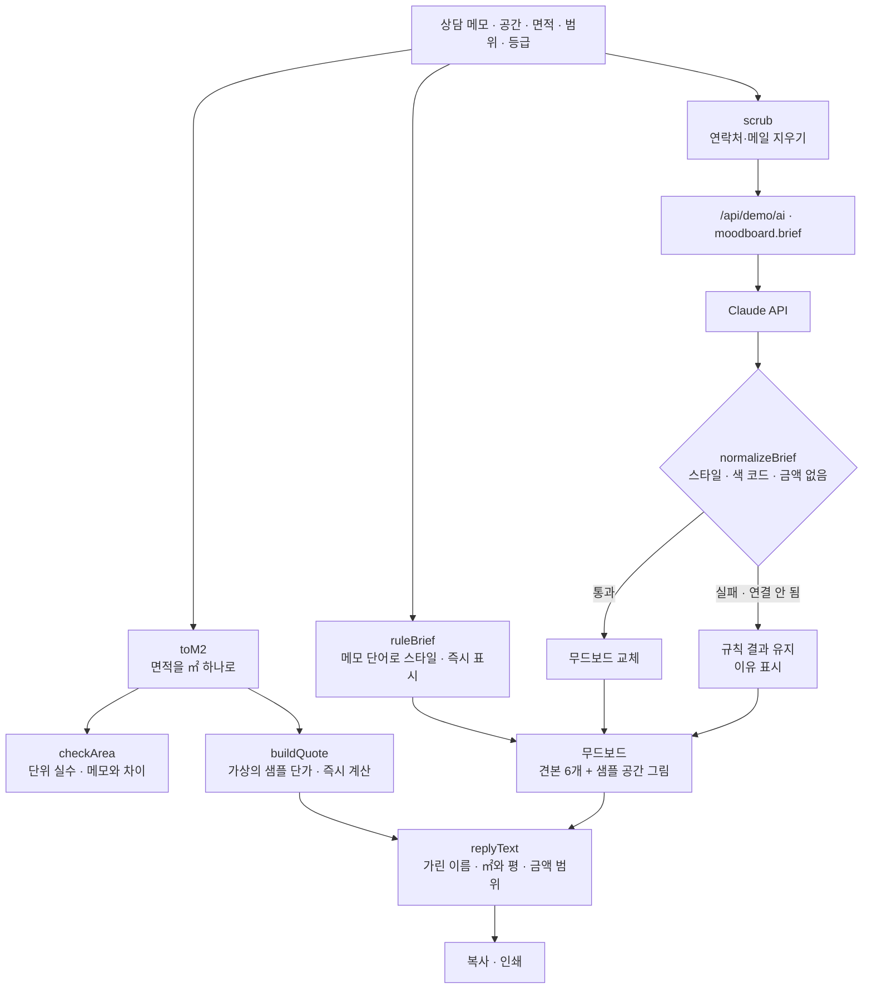

# 구조

## 두 갈래로 나눈 이유

| 부분 | 누가 | 이유 |
|---|---|---|
| 면적 · 수량 · 금액 | `logic.js` 규칙만 | 숫자가 틀리면 신뢰를 잃는다. 같은 입력이면 늘 같은 금액이어야 한다 |
| 스타일 · 색 · 첫 문단 | Claude, 실패하면 규칙 | 메모의 뉘앙스(“하얀 건 차가워 보여서 싫다”)는 말로 읽는 편이 낫다 |

‘무드보드 · 견적 만들기’를 누르면 규칙 결과가 **바로** 나오고, Claude를 기다리는 동안 무드보드가 흐려집니다. 그 사이 다시 누르면 앞의 응답은 버립니다(`runToken`). 면적·범위·등급은 누르지 않아도 입력할 때마다 견적과 회신이 다시 계산됩니다.

## 면적 단위 (이번 프로젝트의 핵심 버그)

1. 입력은 `{value, unit}`으로 받고, 계산에 쓰기 전에 `toM2()`로 ㎡ 하나로 바꾼다. `buildQuote()`는 ㎡만 받는다.
2. 단위 버튼을 바꾸면 **같은 면적이 유지되도록** 숫자를 따라 바꾼다(34평 → 112.4㎡).
3. `checkArea()` — 공간 유형의 보통 범위(㎡)를 벗어났는데 다른 단위로 읽으면 범위 안이면 “단위 실수”로 보고 바로잡기 버튼을 준다. 메모에 적힌 면적(`parseAreas`)과 15% 넘게 다르면 알린다.
4. 화면·회신·인쇄 어디서나 `areaLabel()` → `112.4㎡ (34.0평)`.

## 파일

| 파일 | 하는 일 | DOM |
|---|---|---|
| `logic.js` | 면적 변환·검사, 스타일 고르기, 견적, 응답 검사, 개인정보 지우기·가리기, 회신 문장 | 없음 |
| `ai-client.js` | `/api/demo/ai` 호출, 실패하면 `null` | 없음 |
| `app.js` | 상담 메모 · 무드보드(SVG) · 견적표 · 회신 화면, localStorage(`startup-moodboard-quote-v1`) | 있음 |
| `tests/logic.test.js` | `node --test` 13개 | — |
| `docs/ai-task.json` | 서버 TASKS에 넣을 `moodboard.brief` 정의 | — |
