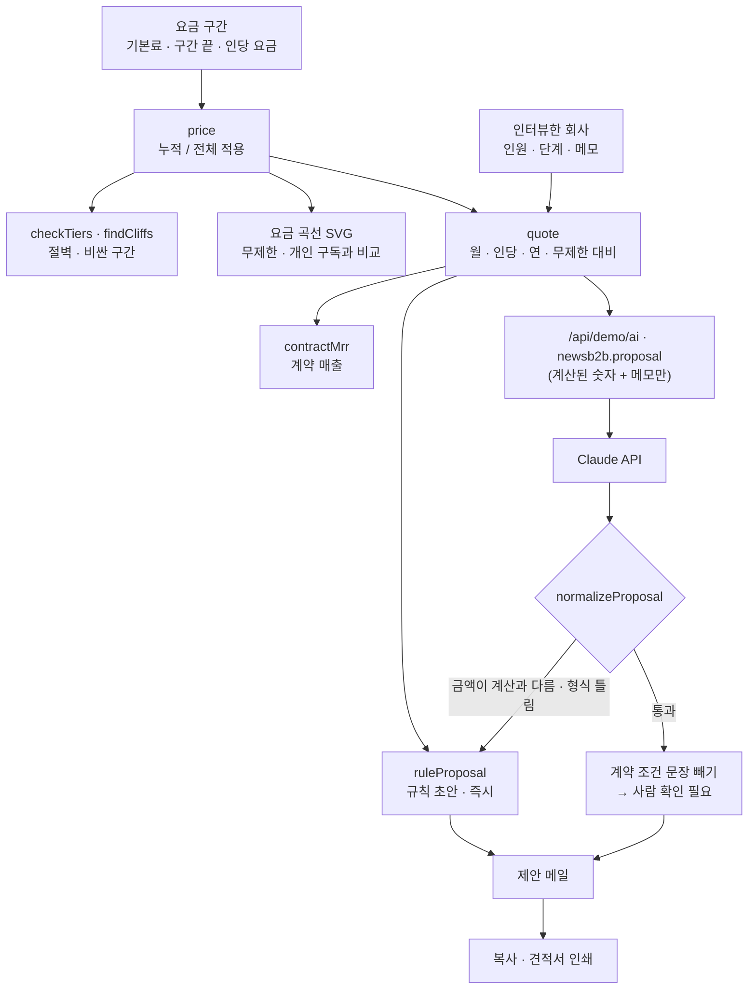

# 구조

## 요금 계산

| 방식 | 식 | 특징 |
|---|---|---|
| 누적 (권장) | 기본료(1~5명) + 6~20명 × 4,500 + 21~50명 × 3,800 + 51명~ × 3,200 | 사람이 늘면 금액이 늘 뿐, 줄지 않는다 |
| 전체 적용 | 인원이 속한 구간 인당 요금 × 전원 | 20명 90,000원 → 21명 79,800원: 경계에서 절벽 |
| (처음 기획) 무제한 | 월 49,000원 | 85명이면 인당 576원 |

`findCliffs`는 1~100명에서 `price(n+1) < price(n)`인 곳을 찾는다. 100명이 넘으면 따로 견적.

## AI / 규칙 분기

| 경우 | 처리 |
|---|---|
| `AI.ask`가 `null` | 규칙 초안 유지, `규칙 기반 · 이유` |
| `subject`/`body`가 문자열이 아님 · 본문이 너무 짧음 | `null` |
| 본문 속 `…원`·`…명` 숫자가 계산값(월·인당·연·개인 요금·인원)에 없음 | `null` (통째로 버림) |
| 계약 조건 단어(해지·환불·위약금·세금계산서·개인정보·약관 등)가 든 문장·질문 | 빼고 `removed`로 화면에 표시 |

사람이 메일을 고치면(`edited`) 견적이 바뀌어도 덮어쓰지 않고 ‘견적이 바뀌었어요’만 알린다.

## 파일

| 파일 | 하는 일 | DOM |
|---|---|---|
| `logic.js` | 샘플 구간·회사, 요금 계산, 절벽·구간 점검, 견적, 규칙 초안, 응답 검사, CSV | 없음 |
| `ai-client.js` | `/api/demo/ai` 호출, 실패하면 `null` | 없음 |
| `app.js` | 구간 표 · 곡선 · 회사 · 제안 메일 | 있음 |
| `tests/logic.test.js` | `node --test` 13개 | — |

## 저장

`localStorage["startup-news-b2b-v1"]`: 요금 구간, 계산 방식, 연 결제, 회사 인원·단계, 초안. 담당자는 직함만 저장한다.
