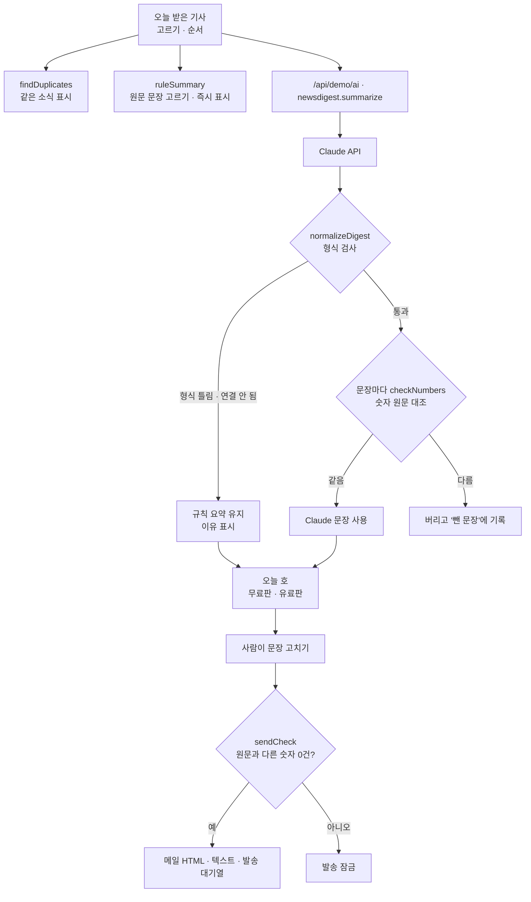

# 구조

## 숫자 대조 (`extractNumbers` · `checkNumbers`)

1. 숫자와 바로 뒤 단위를 함께 뽑는다: `1,240명` → 값 `1240`, 단위 `명`. `42만 건` → 값 `42`, 단위 `만건`.
2. 요약의 숫자마다 원문에 **같은 값**이 있는지 본다. 쉼표 유무는 무시한다.
3. 요약에 단위가 붙어 있으면 원문에서도 같은 단위여야 한다 (`18%` ≠ `18명`). 세는 말만 빠진 `42만`은 원문 `42만 건`과 같다고 본다.
4. 하나라도 원문에 없으면 그 문장은 실패.

규칙 요약은 원문 문장을 그대로 고르므로 이 검사를 항상 통과한다(테스트로 확인).

## AI / 규칙 분기

| 경우 | 처리 |
|---|---|
| `AI.ask`가 `null` (키 없음·한도·네트워크·알 수 없는 작업) | 규칙 요약 그대로, `규칙 기반 · 이유` |
| 응답에 `items` 배열이 없거나 쓸 수 있는 기사가 0건 | `null` → 규칙 요약 유지 |
| 기사별 문장 일부가 숫자 대조 실패 | 그 문장만 버림 |
| 기사별 문장 전부 실패 / Claude가 빠뜨린 기사 | 그 기사만 규칙 요약 (`fellBack`) |
| `intro`·`why`에 원문에 없는 숫자 | 비움 |

그 사이 ‘요약하기’를 다시 누르면 앞의 응답은 버린다(`runToken`).

## 파일

| 파일 | 하는 일 | DOM |
|---|---|---|
| `logic.js` | 샘플 기사, 숫자 뽑기·대조, 규칙 요약, 응답 검사, 같은 소식, 무료/유료판, 발송 검사, 내보내기 | 없음 |
| `ai-client.js` | `/api/demo/ai` 호출, 실패하면 `null` | 없음 |
| `app.js` | 기사 목록 · 오늘 호 · 고치기 · 내보내기 | 있음 |
| `tests/logic.test.js` | `node --test` 14개 | — |
| `docs/ai-task.json` | 서버 TASKS에 합칠 작업 정의 | — |

## 저장

`localStorage["startup-news-digest-v1"]`: 고른 기사 순서, 직접 넣은 기사, 고친 문장, 무료/유료판. 구독자 정보는 저장하지 않는다.
