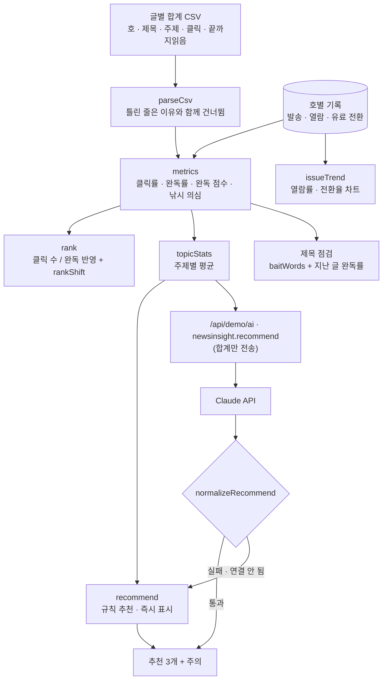

# 구조

## 지표

| 지표 | 식 | 왜 |
|---|---|---|
| 클릭률 | 클릭 ÷ 그 호 열람자 | 호마다 열람자 수가 달라서 클릭 수를 그대로 비교하지 않는다 |
| 완독률 | 끝까지 읽음 ÷ 클릭 | 들어온 사람이 실제로 읽었는지 |
| 완독 점수 | 끝까지 읽음 ÷ 그 호 열람자 × 100 | 클릭률 × 완독률. ‘열람자 100명당 끝까지 읽은 사람’ |
| 낚시 의심 | 클릭률 ≥ 중앙값 × 1.3 그리고 완독률 < 30% | 클릭률이 낮은 글은 완독률이 낮아도 낚시로 보지 않는다 |

## AI / 규칙 분기

| 경우 | 처리 |
|---|---|
| `AI.ask`가 `null` | 규칙 추천 그대로, `규칙 기반 · 이유` |
| `topics` 배열이 없음 · 쓸 수 있는 주제 0개 | `null` → 규칙 추천 유지 |
| input에 없는 주제 · 중복 | 뺌 |
| 이유 속 숫자가 input에 없음 | 그 주제의 규칙 문장으로 바꿈 |
| 제목 아이디어에 낚시 표현 | 비움 |

Claude에게는 글 원문이나 구독자 기록이 아니라 **계산이 끝난 주제별 합계**만 보낸다(`aiInput`).

## 파일

| 파일 | 하는 일 | DOM |
|---|---|---|
| `logic.js` | 샘플(41~48호), CSV 검사, 지표, 순위, 주제 통계, 추천 규칙, 응답 검사, CSV 내보내기 | 없음 |
| `ai-client.js` | `/api/demo/ai` 호출, 실패하면 `null` | 없음 |
| `app.js` | 차트 · 순위표 · 추천 · 제목 점검 | 있음 |
| `tests/logic.test.js` | `node --test` 13개 | — |

## 저장

`localStorage["startup-news-insight-v1"]`: CSV, 순위 기준, 기간, 점검 중인 제목, 마지막 추천. 구독자 개인 기록은 다루지 않는다.
