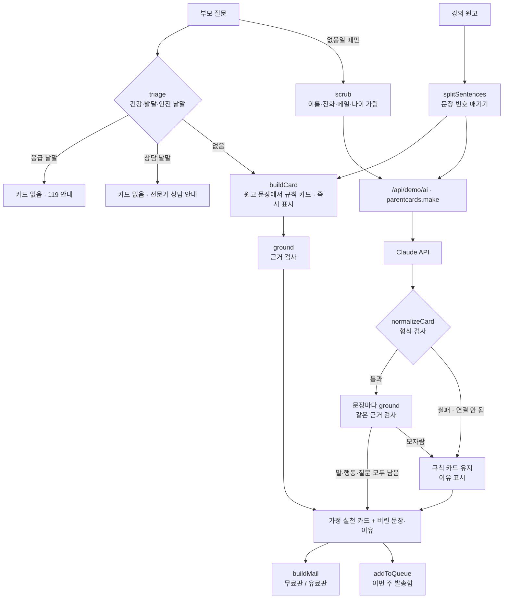

# 집으로 · 구조

## 근거 검사 (`ground`)

카드 문장 하나 `{text, refs}`를 원고 문장과 맞춰 본다. 위에서부터 하나라도 걸리면 버린다.

| 검사 | 버리는 경우 | 예 |
|---|---|---|
| 근거 번호 | refs가 비었거나 원고에 없는 번호 | `refs: [40]` |
| 의학·발달 낱말 | 카드에 있고 근거 문장에는 없는 `MED` 낱말 (낱말 + 조사로 찾음, ‘약속’은 ‘약’ 아님) | 멜라토닌, 약, 진단, 정상 발달 |
| 숫자 기준 | 근거 문장에 없는 ‘숫자 + 개월·살·시간·분·회’ | 하루 1시간 |
| 일치율 | 카드 문장의 글자쌍 중 근거 문장에 있는 비율이 60% 미만 | 원고와 다른 새 조언 |

규칙 카드는 원고 문장을 그대로 쓰므로 늘 통과하지만, 같은 검사를 거쳐 일치율을 화면에 보여 준다.

## 사람에게 넘기기 (`triage`)

부모 질문은 카드를 만들기 전에 먼저 본다. 건강·발달 낱말이면 상담 안내, 응급 낱말이면 119 안내를 띄우고 **카드도, AI 호출도 하지 않는다.** 질문은 localStorage에 저장하지 않는다.

## 파일

| 파일 | 하는 일 | DOM |
|---|---|---|
| `logic.js` | 샘플 원고 3개, 문장 나누기, 규칙 카드, 근거 검사, 응답 검사, 질문 분류, 개인정보 가리기, 메일·발송함·구독 계산 | 없음 |
| `ai-client.js` | `/api/demo/ai` 호출, 실패하면 `null` (공통 파일, 수정 금지) | 없음 |
| `app.js` | 원고 · 카드 · 메일 미리보기 · 검사기 · 발송함 화면, localStorage | 있음 |
| `tests/logic.test.js` | `node --test` 13개 | — |

## 저장

- `localStorage["startup-parent-cards-v1"]` — 고른 강의, 고친 원고, 다른 문장 보기 횟수, 무료/유료 미리보기, 발송함.
- 부모 질문은 저장하지 않고, AI에는 가린 질문만 보낸다.
