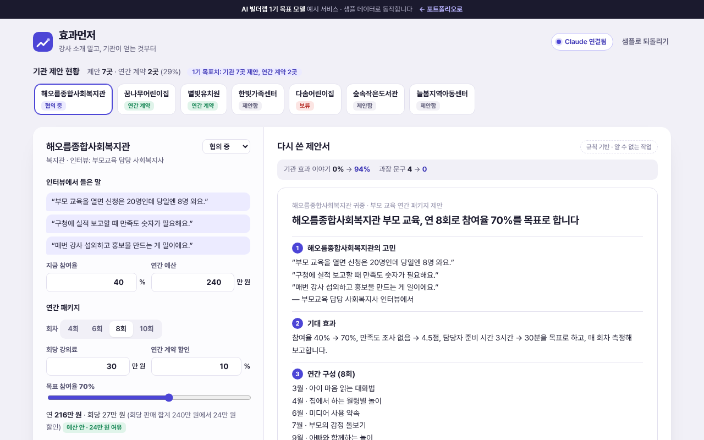

# 효과먼저

> 강사 소개 위주였던 부모 교육 제안서를 **기관이 얻는 효과(참여율·만족도·운영 부담) 중심**으로 다시 쓰고, 연간 패키지 가격과 기관 제안 현황을 함께 관리하는 도구

   



**데모** · https://aibuilderlab.kr/demo/startup-parent-proposal/index.html

> **알림** AI 빌더랩 창업 트랙 **1기 목표 모델(가상의 수강생 ‘한걸음부모’)** 의 예시 프로젝트입니다. 기관·담당자·금액은 모두 가상이고, 결과 숫자는 1기 목표치입니다.

## 문제 → 해결

| 문제 | 해결 |
|---|---|
| 강의를 회당으로만 팔아 일정이 들쭉날쭉했다 | 기관마다 **연간 패키지**(회차 · 회당 강의료 · 연간 할인)로 제안하고 기관 예산 안인지 바로 확인 |
| 제안서가 강사 소개 위주였다 (전공·경력·출강 이력) | **제안서 점검기** — 문장마다 ‘기관 효과 / 강사 중심’으로 나눠 비율을 보여 주고 60% 미만이면 고칠 곳 표시 |
| 기관이 실제로 원하는 것(참여율, 평가·실적용 만족도 숫자, 담당자 일 줄이기)이 빠져 있었다 | 기관 인터뷰의 말로 시작해 기대 효과 → 연간 구성 → 측정과 보고 → 비용 → 강사(맨 뒤) 순서로 다시 쓴다 |
| “최고의 강의, 만족 보장” 같은 문구 | 과장 문구를 찾아 표시하고, Claude가 쓴 문장에 있으면 지운다. 목표 수치는 ‘약속이 아닌 측정 기준’으로 적는다 |

## 주요 기능

- **기관 제안 현황** — 7곳의 진행 상태(제안 전·제안함·협의 중·연간 계약·보류). 상태를 바꾸면 ‘제안 n곳 · 연간 계약 n곳’이 다시 계산된다.
- **처음 쓴 제안서 점검** — 비율 막대, 문장별 분류, 과장 문구 형광펜.
- **다시 쓰기** — 전후 비교(`기관 효과 이야기 0% → 94%`, `과장 문구 4 → 0`), 측정 지표 표(지금 → 목표 · 어떻게 재나).
- **연간 패키지** — 4·6·8·10회, 회당 강의료, 할인율, 목표 참여율. 예산 초과면 회차 조정 안내.
- **인쇄 · PDF / 글로 복사** — 인쇄하면 제안서 본문만 나온다.

## AI는 이렇게 동작합니다

| 상황 | 동작 | 화면 표시 |
|---|---|---|
| Claude 연결됨 | `parentproposal.rewrite` → 검사(`normalizeRewrite`: 과장 문장 삭제, 강사 소개 맨 뒤, 비용·지표는 계산값으로 고정) | `Claude로 다시 씀 · 2.1초`, 삭제한 과장 문장 수 |
| AI 키 없음 · 한도 초과 · 작업 없음 · 네트워크 오류 | 인터뷰·패키지로 채우는 규칙 템플릿 | `규칙 기반 · (이유)` |
| 응답 형식이 틀림 (제목 없음, 절 3개 미만 등) | 버리고 규칙 결과 유지 | `규칙 기반 · 응답 형식이 맞지 않음` |

금액과 지표 숫자는 Claude가 쓰지 않습니다. 화면이 계산한 값을 넣습니다. 자세한 흐름은 [docs/ARCHITECTURE.md](docs/ARCHITECTURE.md), 지시문 원문은 [docs/PROMPTS.md](docs/PROMPTS.md), 서버 작업 정의는 [docs/ai-task.json](docs/ai-task.json).

## 기술 스택

| 구분 | 이 데모 | 실제 버전 (포트폴리오) |
|---|---|---|
| 설계 | 점검기 · 템플릿 · 가격 계산 | 기관 인터뷰 · 제안서 설계 |
| 저장 | localStorage (`startup-parent-proposal-v1`) | 문서 · 시트 |
| AI | Claude API — 서버 `aibuilderlab.kr/api/demo/ai` | 같음 |
| 테스트 | Node 내장 `node:test` 12개 | — |

## 폴더 구조

```
startup-parent-proposal/
├── index.html
├── style.css
├── logic.js          문장 점검 · 가격 · 연간 구성 · 지표 · 규칙 제안서 · 응답 검사 · 제안 현황 (DOM 없음)
├── ai-client.js      /api/demo/ai 호출, 실패하면 null
├── app.js            제안 현황 · 기관/패키지 · 점검 · 제안서 화면
├── tests/logic.test.js
├── docs/ (ARCHITECTURE · DEVLOG · PROMPTS · ai-task.json)
├── CHANGELOG.md
└── package.json
```

## 실행 · 테스트

```bash
python3 -m http.server 8000   # http://localhost:8000
npm test                      # = node --test, 12개
```

## AI 활용 기록 (COVI 기록 요약)

| 프롬프트 | 디버깅 | 걸린 시간 |
|---|---|---|
| 16회 | 0회 | 3시간 |

- **막혔던 문제** — 제안서가 강사 소개 위주 → 기관이 얻는 효과(참여율·만족도) 중심으로 재구성
- **결과 (1기 목표치)** — 기관 7곳 제안, 연간 계약 2곳
- 주차별 기록: [docs/DEVLOG.md](docs/DEVLOG.md)
