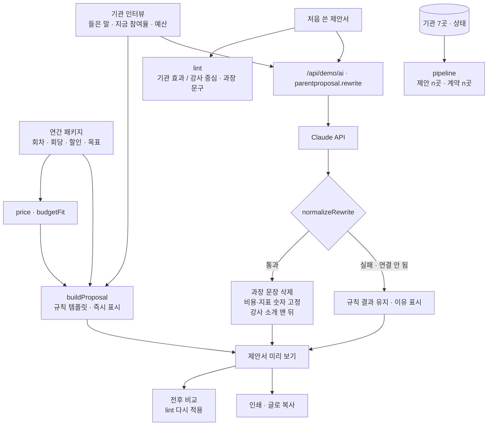

# 효과먼저 · 구조

## 점검 규칙 (`lint`)

| 분류 | 찾는 말 (일부) | 예 |
|---|---|---|
| 기관 효과 | 참여율, 출석, 만족도, 부모님, 담당자, 운영, 평가, 보고, 실적 | “회차마다 출석부와 만족도 설문 결과를 드립니다.” |
| 강사 중심 | 저는, 제가, 경력, 전공, 자격, 출강, 수상, ○년 동안 | “복지관과 어린이집 50여 곳에 출강했습니다.” |
| 기타 | 둘 다 없음 (주제 목록, 인사) | “강의 주제는 놀이입니다.” |

- 두 쪽 낱말 수가 같으면 강사 중심으로 본다(보수적으로).
- 비율은 기관 효과 + 강사 중심 문장 안에서 잰다. 목표: 기관 효과 60% 이상, 과장 문구 0개.
- 과장 문구: 반드시, 무조건, 100%, 최고, 보장, 완벽, 확실히, 누구나, 획기적, 압도적.

## Claude 결과를 믿지 않는 곳

| 항목 | 처리 |
|---|---|
| 비용 | Claude에 금액을 보내지 않고, 돌아온 ‘비용’ 절은 `price()`로 계산한 문장으로 바꾼다 |
| 지표 표 | 항상 `metrics()` 값 (지금 숫자는 인터뷰, 목표는 강사가 정한 값) |
| 과장 문장 | 문장째 지우고 개수를 화면에 표시 |
| 강사 소개 | 제목에 ‘강사’·‘소개’가 있으면 맨 뒤로 |

## 파일

| 파일 | 하는 일 | DOM |
|---|---|---|
| `logic.js` | 문장 점검, 가격·예산, 연간 구성, 지표, 규칙 제안서, 응답 검사, 복사 글, 제안 현황 | 없음 |
| `ai-client.js` | `/api/demo/ai` 호출, 실패하면 `null` (공통 파일, 수정 금지) | 없음 |
| `app.js` | 제안 현황 · 기관/패키지 · 점검 · 제안서 화면, 인쇄 | 있음 |
| `tests/logic.test.js` | `node --test` 12개 | — |
