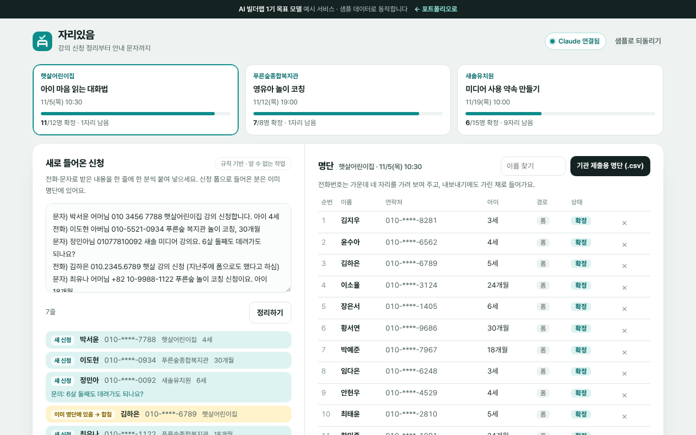

# 자리있음

> 복지관·어린이집 강의 신청을 전화·문자로 받은 그대로 붙여 넣으면 명단으로 정리하고, **전화번호 기준으로 중복을 합치고**, 정원·대기와 안내 문자까지 만드는 부모 교육 강사용 도구

   



**데모** · https://aibuilderlab.kr/demo/startup-parent-signup/index.html

> **알림** AI 빌더랩 창업 트랙 **1기 목표 모델(가상의 수강생 ‘한걸음부모’)** 의 예시 프로젝트입니다. 기관·신청자·전화번호는 모두 가상이고, 결과 숫자는 1기 목표치입니다.

## 문제 → 해결

| 문제 | 해결 |
|---|---|
| 강의 신청을 전화·문자로 받아 명단 정리가 늘 꼬였다 (회당 1시간) | 메모를 붙여 넣고 ‘정리하기’ → 이름·번호·강의·아이 나이를 읽어 미리 보기 → ‘명단에 넣기’ |
| 같은 사람이 폼으로 한 번, 전화로 또 한 번 신청해 자리가 두 개 잡혔다 | **전화번호 + 강의 기준 중복 확인**. 번호 모양(`010 3456 7788`, `+82 10-…`)이 달라도 같은 번호로 보고 한 명으로 합친다 |
| 정원이 넘었는지 세다가 대기 안내를 놓쳤다 | 먼저 신청한 순서대로 확정, 넘치면 대기 번호. 누군가 빠지면 대기가 자동으로 당겨진다 |
| 확정·대기 안내 문자를 한 명씩 고쳐 썼다 | 문구 하나에 {이름}·{강의}·{일시} 칸. 오타 칸(`{이룸}`)은 복사 전에 막는다 |

## 주요 기능

- **메모 정리** — 한 줄에 한 분. 번호나 강의를 못 찾은 줄은 ‘확인 필요’로 따로 모아 메모에 남겨 둔다.
- **중복 확인** — 기존 명단(폼)과 겹치면 ‘이미 명단에 있음 → 합침’, 메모 안에서 겹치면 ‘메모 안에서 중복 → 합침’. 순서는 먼저 신청한 쪽을 지키고, 비어 있던 아이 나이·문의만 채운다. 같은 번호에 이름이 다르면 확인 표시.
- **강의별 정원·대기** — 카드에서 확정/정원·대기 수, 명단에서 빼기 + 되돌리기.
- **안내 문자** — 확정·대기 문구 편집, 미리 보기, 복사 (데모는 실제 발송하지 않음).
- **기관 제출용 명단 CSV** — 전화번호를 가린 채로 내보낸다.

## AI는 이렇게 동작합니다

| 상황 | 동작 | 화면 표시 |
|---|---|---|
| Claude 연결됨 | 번호를 `[전화1]`로 가린 메모 → `parentsignup.parse` → 형식 검사(`normalizeParse`) → 번호표로 되돌림 | `Claude로 정리 · 2.1초` |
| AI 키 없음 · 한도 초과 · 작업 없음 · 네트워크 오류 | 번호·강의 이름·호칭을 읽는 규칙 정리 | `규칙 기반 · (이유)` |
| 응답 형식이 틀림 · 번호표에 없는 번호 | 그 항목을 버리고, 모두 틀리면 규칙 결과 유지 | `규칙 기반 · 응답 형식이 맞지 않음` |

**중복 확인은 AI에 맡기지 않습니다.** 정리는 Claude가 해도 합치기는 항상 `dedupe()`가 전화번호로 합니다. 자세한 흐름은 [docs/ARCHITECTURE.md](docs/ARCHITECTURE.md), 지시문 원문은 [docs/PROMPTS.md](docs/PROMPTS.md), 서버 작업 정의는 [docs/ai-task.json](docs/ai-task.json).

## 기술 스택

| 구분 | 이 데모 | 실제 버전 (포트폴리오) |
|---|---|---|
| 신청 받기 | 메모 붙여 넣기 + 샘플 폼 응답 | 신청 폼 |
| 명단 | localStorage (`startup-parent-signup-v1`) | 시트 |
| 안내 | 문자 내용 복사 | 안내 문자 발송 |
| AI | Claude API — 서버 `aibuilderlab.kr/api/demo/ai` | 같음 |
| 테스트 | Node 내장 `node:test` 13개 | 같음 |

## 폴더 구조

```
startup-parent-signup/
├── index.html
├── style.css
├── logic.js          번호 정리·가리기 · 메모 정리 · 응답 검사 · 중복 확인 · 정원 · 문자 · CSV (DOM 없음)
├── ai-client.js      /api/demo/ai 호출, 실패하면 null
├── app.js            강의 카드 · 메모 · 명단 · 안내 문자 화면
├── tests/logic.test.js
├── docs/ (ARCHITECTURE · DEVLOG · PROMPTS · ai-task.json)
├── CHANGELOG.md
└── package.json
```

## 실행 · 테스트

```bash
python3 -m http.server 8000   # http://localhost:8000
npm test                      # = node --test, 13개
```

## AI 활용 기록 (COVI 기록 요약)

| 프롬프트 | 디버깅 | 걸린 시간 |
|---|---|---|
| 23회 | 3회 | 4시간 |

- **막혔던 문제** — 같은 사람이 두 번 신청 → 전화번호 기준 중복 확인 추가
- **결과 (1기 목표치)** — 명단 정리 회당 1시간 → 10분, 강의 월 6회 → 11회
- 주차별 기록: [docs/DEVLOG.md](docs/DEVLOG.md)
