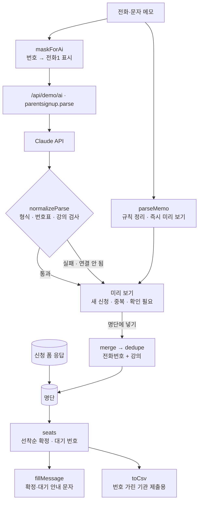

# 자리있음 · 구조

## 중복 확인 (`dedupe`)

| 규칙 | 이유 |
|---|---|
| 열쇠는 `정규화한 전화번호 + 강의` | 이름은 ‘김하은’/‘하은맘’처럼 바뀌지만 번호는 그대로다 |
| 번호 정규화: 숫자만 남기고 `82`→`0`, 10자리면 앞에 `0` | `010 3456 7788`, `010.3456.7788`, `+82 10-3456-7788`이 같은 번호 |
| 같은 번호라도 다른 강의면 따로 | 한 부모가 두 강의를 듣는 경우 |
| 먼저 신청한 쪽의 순서를 지킨다 | 다시 연락했다고 순서가 밀리면 안 된다 |
| 비어 있던 값만 나중 신청에서 채운다 | 아이 나이를 두 번째에만 말한 경우 |
| 같은 번호에 이름이 다르면 ‘이름 확인’ 표시 | 부부가 한 번호로 신청했을 수 있어 사람이 판단 |

## 개인정보

- Claude에는 전화번호를 보내지 않는다. `[전화1]`로 바꿔 보내고, 돌아온 표시를 화면의 번호표(`map`)로 되돌린다. 표에 없는 번호가 오면 그 항목은 버린다.
- 화면·CSV·문자 복사본에는 번호 가운데 네 자리를 가린다(`010-****-6789`). 문자 복사본에는 번호를 넣지 않는다.
- 데모는 가상 번호를 localStorage에 둔다. 실제 버전은 시트 접근 권한을 강사 계정으로 제한한다.

## 파일

| 파일 | 하는 일 | DOM |
|---|---|---|
| `logic.js` | 번호 정리·가리기, 메모 정리, 응답 검사, 중복 확인, 정원, 안내 문자, CSV | 없음 |
| `ai-client.js` | `/api/demo/ai` 호출, 실패하면 `null` (공통 파일, 수정 금지) | 없음 |
| `app.js` | 강의 카드 · 메모 미리 보기 · 명단 · 안내 문자 화면 | 있음 |
| `tests/logic.test.js` | `node --test` 13개 | — |
