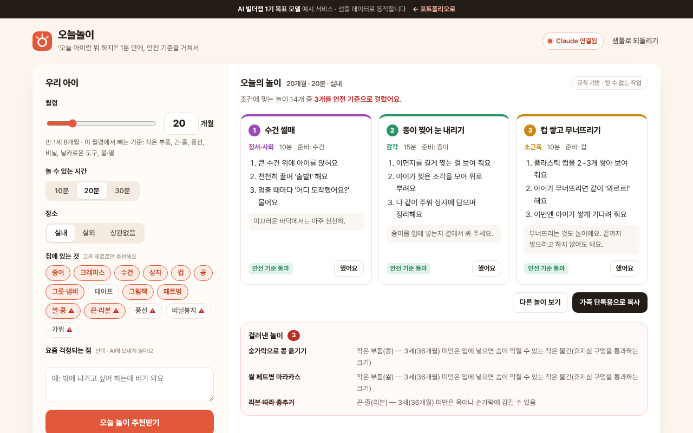

# 오늘놀이

> 아이 월령·놀 수 있는 시간·집에 있는 재료를 고르면 놀이 3개를 추천하고, **안전 기준 목록(작은 부품·끈·풍선 등)으로 한 번 더 걸러** 걸러낸 이유까지 보여 주는 부모용 서비스

   



**데모** · https://aibuilderlab.kr/demo/startup-play-pick/index.html

> **알림** AI 빌더랩 창업 트랙 **1기 목표 모델(가상의 수강생 ‘놀이처방전’)** 의 예시 프로젝트입니다. 아이·가정·숫자는 모두 가상이고, 결과 숫자는 1기 목표치입니다. 이 서비스는 의료·발달 판단을 하지 않습니다.

## 문제 → 해결

| 문제 | 해결 |
|---|---|
| 부모 교육 강의 뒤 “집에서 매일 뭘 해 줘야 하냐”는 질문에 개별로 답할 수 없었다 | 월령·시간·장소·재료를 고르면 1분 안에 놀이 3개 (영역이 겹치지 않게) |
| AI가 18개월 아이에게 ‘콩 옮기기’처럼 월령에 맞지 않는 위험한 놀이를 추천했다 | 규칙이든 Claude든 마지막에 **안전 기준 목록**으로 거르고, 걸러낸 놀이와 이유를 화면에 남긴다 |
| 부모가 인터넷에서 본 놀이가 괜찮은지 물어 왔다 | ‘놀이 아이디어 안전 검사’ — 적으면 지금 월령 기준으로 뺄지·주의할지 바로 알려 준다 |
| 발달·건강 걱정을 놀이 추천에 섞어 묻는 경우 | 걱정 메모에 건강·발달 낱말이 있으면 **판단하지 않고** 의료진·전문가 상담을 안내, 응급 낱말이면 추천을 멈춘다 |

## 주요 기능

- **오늘의 놀이 3개** — 강사가 정리한 놀이 24개에서 월령·시간·장소·재료로 고르고, 이번 주에 덜 한 영역(대근육·소근육·언어·감각·정서·사회)을 먼저.
- **안전 기준 거름** — 8개 기준(작은 부품, 끈·줄, 풍선, 비닐, 날카로운 도구, 불·열, 물, 높은 곳). 월령 미만이면 빼고, 그 위에서는 주의 문장을 붙인다. 이 월령에서 빠지는 재료는 고르는 칸에 ⚠ 표시.
- **다른 놀이 보기** — 방금 본 놀이를 빼고 다시 고른다.
- **이번 주 놀이 기록** — ‘했어요’를 누르면 영역별 막대가 쌓이고 다음 추천에 반영된다 (되돌리기 가능).
- **가족 단톡용 복사** — 아이 이름 없이 월령·놀이·순서·주의만 담은 글.
- **사람에게 넘기기** — 걱정 메모는 AI에 보내지 않고 저장하지도 않는다.

## AI는 이렇게 동작합니다

| 상황 | 동작 | 화면 표시 |
|---|---|---|
| Claude 연결됨 | `playpick.recommend` → 형식 검사(`normalizePlays`) → **안전 기준 거름(`screenAi`)** | `Claude로 추천 · 2.1초`, Claude 추천 중 걸러낸 개수 |
| AI 키 없음 · 한도 초과 · 작업 없음 · 네트워크 오류 | 강사 놀이 목록에서 규칙 추천 (같은 안전 기준) | `규칙 기반 · (이유)` |
| 응답 형식이 틀림 | 버리고 규칙 결과 유지 | `규칙 기반 · 응답 형식이 맞지 않음` |
| Claude 추천이 모두 안전 기준에 걸림 | 버리고 규칙 결과 유지 | `규칙 기반 · 추천이 모두 안전 기준에 걸림` |

Claude에게는 월령·시간·장소·재료·이번 주 영역 횟수·피할 기준만 보냅니다. 아이 이름과 걱정 메모는 보내지 않습니다. 자세한 흐름은 [docs/ARCHITECTURE.md](docs/ARCHITECTURE.md), 지시문 원문은 [docs/PROMPTS.md](docs/PROMPTS.md), 서버에 넣을 작업 정의는 [docs/ai-task.json](docs/ai-task.json).

## 기술 스택

| 구분 | 이 데모 | 실제 버전 (포트폴리오) |
|---|---|---|
| 화면 | HTML · CSS · JavaScript (빌드 없음) | Next.js |
| 저장 | localStorage (`startup-play-pick-v1`) | Supabase (부모 계정·놀이 기록·구독) |
| AI | Claude API — 서버 `aibuilderlab.kr/api/demo/ai` | Claude API |
| 테스트 | Node 내장 `node:test` 16개 | 같음 |

## 폴더 구조

```
startup-play-pick/
├── index.html
├── style.css
├── logic.js          놀이 목록 · 안전 기준 · 규칙 추천 · 응답 검사 · 걱정 분류 · 공유 글 (DOM 없음)
├── ai-client.js      /api/demo/ai 호출, 실패하면 null
├── app.js            조건 · 추천 결과 · 기록 · 아이디어 검사 화면
├── tests/logic.test.js
├── docs/ (ARCHITECTURE · DEVLOG · PROMPTS · ai-task.json)
├── CHANGELOG.md
└── package.json
```

## 실행 · 테스트

```bash
python3 -m http.server 8000   # http://localhost:8000
npm test                      # = node --test, 16개
```

## AI 활용 기록 (COVI 기록 요약)

| 프롬프트 | 디버깅 | 걸린 시간 |
|---|---|---|
| 50회 | 8회 | 9시간 |

- **막혔던 문제** — AI가 월령에 맞지 않는 위험한 놀이(작은 부품)를 추천 → 안전 기준 목록으로 걸러냄
- **결과 (1기 목표치)** — 가입 부모 530명, 월 구독 74명(월 4,900원)
- 주차별 기록: [docs/DEVLOG.md](docs/DEVLOG.md)
