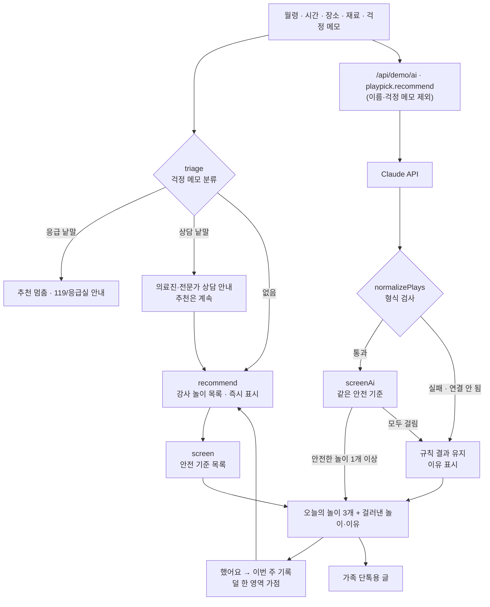

# 오늘놀이 · 구조

## 안전 기준이 두 번 작동하는 이유

1. **월령 범위** — 놀이 목록의 `min`·`max`는 발달 기준이다. ‘콩 옮기기’는 18개월부터 손 조절 연습으로 좋다.
2. **안전 기준 목록** (`SAFETY`) — 발달 기준과 따로, 물건 자체의 위험을 본다. 같은 ‘콩 옮기기’도 36개월 미만이면 뺀다.

Claude가 지어 준 놀이는 1번이 없으므로 2번이 유일한 그물이다. 그래서 규칙 결과와 Claude 결과가 **같은 `screen()`** 을 거친다.

## 낱말 찾기 (`hasWord`)

글을 기호·띄어쓰기로 자른 뒤, 조각이 기준 낱말로 시작하고 나머지가 조사(`을`, `으로`, `알` …)일 때만 찾은 것으로 본다.

| 글 | 낱말 | 결과 |
|---|---|---|
| 콩을 옮겨요 | 콩 | 찾음 |
| 콩콩 뛰어요 | 콩 | 아님 |
| 실내에서 | 실 | 아님 |
| 물감으로 | 물 | 아님 |

‘단추 같은 작은 물건은 치워요’ 같은 안내 문장도 걸릴 수 있다. 의심되면 빼는 쪽이 이 서비스의 원칙이라 그대로 둔다.

## 파일

| 파일 | 하는 일 | DOM |
|---|---|---|
| `logic.js` | 놀이 목록 24개, 안전 기준 8개, 규칙 추천, 응답 검사, 걱정 분류, 기록, 공유 글 | 없음 |
| `ai-client.js` | `/api/demo/ai` 호출, 실패하면 `null` (공통 파일, 수정 금지) | 없음 |
| `app.js` | 조건 · 결과 · 기록 · 아이디어 검사 화면, localStorage | 있음 |
| `tests/logic.test.js` | `node --test` 16개 | — |

## 저장

- `localStorage["startup-play-pick-v1"]` — 조건(걱정 메모 제외), 다른 놀이 보기 횟수, 놀이 기록.
- 걱정 메모는 저장하지 않고 AI에도 보내지 않는다.
