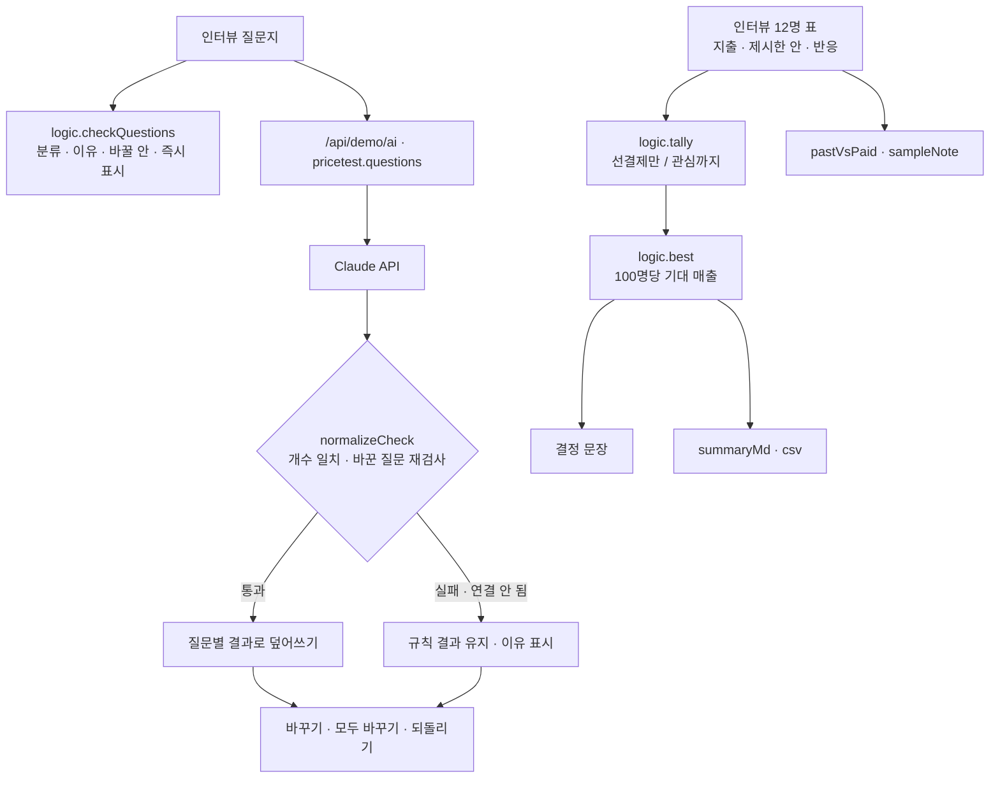

# 구조

## 가격을 정하는 법

1. 한 사람에게 **한 안만** 보여 준다 (여러 가격을 나란히 보면 가운데를 고르기 쉽다).
2. ‘쓸게요’가 아니라 **예약금(선결제)** 을 낸 사람만 결제로 센다.
3. 안마다 `결제율 = 선결제 ÷ 제시`, `100명당 기대 매출 = 가격 × 결제율 × 100`.
4. 기대 매출이 가장 큰 안을 고르고, 같으면 결제율이 높은 쪽.
5. 안마다 10명 미만이면 ‘방향을 보는 숫자’라고 알린다.

## AI / 규칙 분기

| 단계 | 규칙 | Claude |
|---|---|---|
| 분류 | 표현 패턴 (‘~실 건가요’, ‘~겠죠?’, ‘얼마면’, ‘지난·마지막으로’) | 문맥으로 |
| 바꿀 안 | 주제별 틀 5개 (가격·숙제·앱·수업·기타) | 질문에 맞춰 직접 |
| 검사 | — | 개수·불리언 검사, 바꾼 질문을 규칙으로 다시 분류해 또 유도형이면 규칙의 안 |
| 가격 결정 | 항상 규칙(계산) | 쓰지 않음 |

## 파일

| 파일 | 하는 일 | DOM |
|---|---|---|
| `logic.js` | 질문 분류, 바꿀 안, 응답 검사, 가격 집계, 결정, 지난 행동 비교, 요약, CSV | 없음 |
| `ai-client.js` | `/api/demo/ai` 호출, 실패하면 `null` | 없음 |
| `app.js` | 질문지, 가격 실험, 인터뷰 표, 내보내기 | 있음 |
| `tests/logic.test.js` | `node --test` 11개 | — |
