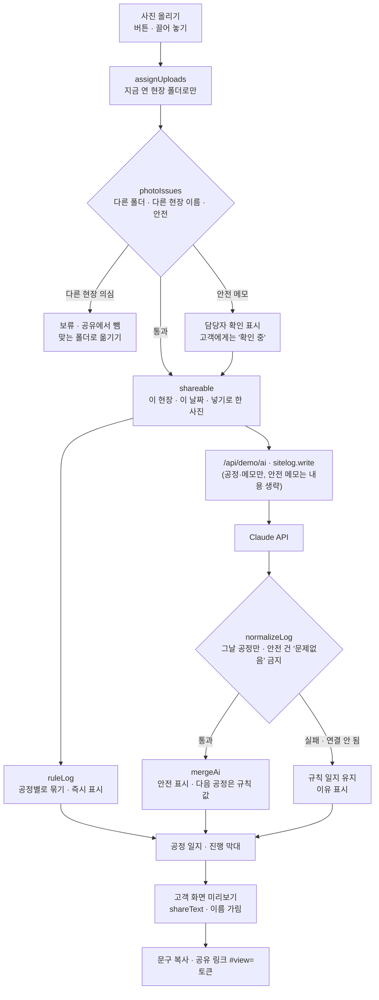

# 구조

## 현장 폴더 (이번 프로젝트의 핵심 버그)

예전에는 사진을 한곳에 몰아 올리고 골라 보냈더니, 같은 날 다녀온 다른 현장 사진이 섞여 고객에게 갔다.

1. 업로드는 **지금 연 폴더**로만 들어간다(`assignUploads`). 폴더를 고르지 않고 올릴 방법이 없다.
2. 휴대폰에서 파일 이름 앞에 현장 코드를 붙여 찍는 습관(`B현장_도배_1420.jpg`)을 이용해, 코드가 폴더와 다르면 보류한다(`siteCodeOf`).
3. 보류한 사진은 `shareable()`에서 빠지고, 공정 진행 계산에서도 빠진다. ‘B현장 폴더로 옮기기’를 누르면 맞는 폴더로 간다.

## 안전 메모는 사람에게

`safetyFlag()`가 누수·균열·누전·구조·석면·가스·곰팡이 표현을 찾으면

- 내 일지: 노란 ‘담당자 확인 필요’ 표시
- AI 입력: 메모 내용 대신 “안전 확인 필요 (담당자가 판단, 내용 생략)”
- AI 응답: 안전 건이 있는데 ‘문제없다·이상 없다·안전하다’가 있으면 버림
- 고객 문구: “담당자가 현장에서 직접 확인한 뒤 따로 연락드립니다”

## 파일

| 파일 | 하는 일 | DOM |
|---|---|---|
| `logic.js` | 공정 짐작, 현장 코드·폴더 검사, 안전 표시, 진행, 규칙 일지, 응답 검사·합치기, 공유 문구·토큰 | 없음 |
| `ai-client.js` | `/api/demo/ai` 호출, 실패하면 `null` | 없음 |
| `app.js` | 현장 폴더 · 사진 카드(SVG 샘플 그림) · 일지 · 고객 화면, localStorage(`startup-site-log-v1`, 직접 올린 사진 파일은 저장하지 않음) | 있음 |
| `tests/logic.test.js` | `node --test` 12개 | — |
| `docs/ai-task.json` | 서버 TASKS에 넣을 `sitelog.write` 정의 | — |
