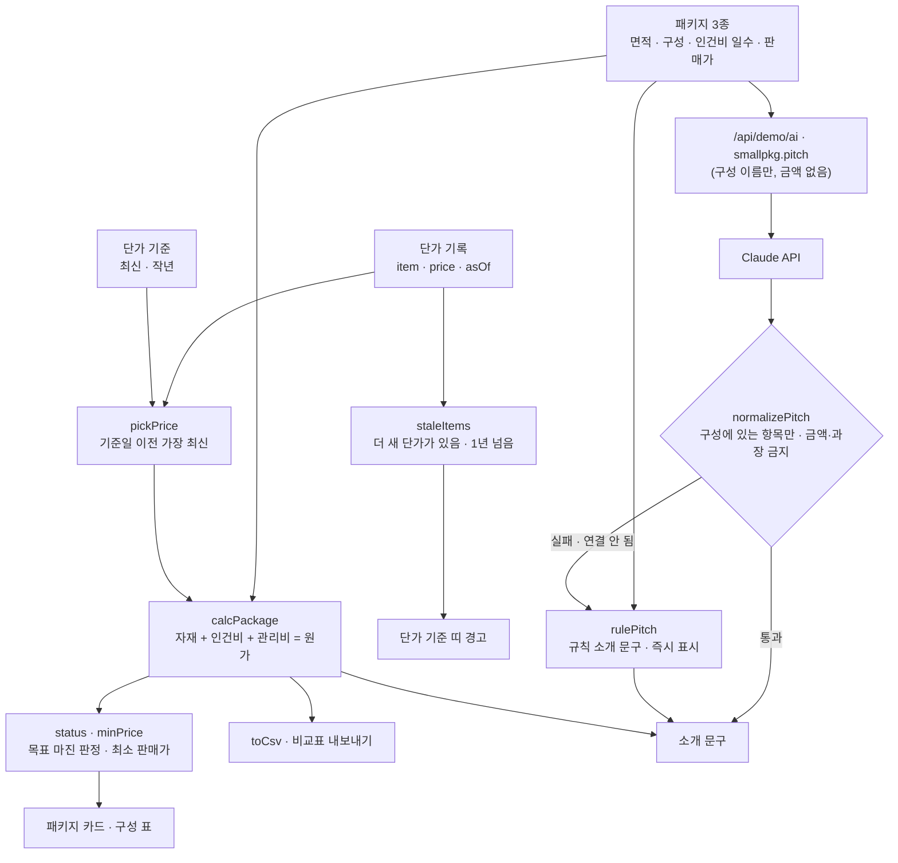

# 구조

## 단가 기준일 (이번 프로젝트의 핵심 실수)

처음 기획할 때 자재 단가표를 작년 것 그대로 썼다. 원룸 기본 마진이 30%로 보여 그 가격으로 내놓을 뻔했는데, 최신 단가로 다시 계산하니 21%, 투룸 기본은 목표(20%) 아래였다.

1. 단가는 덮어쓰지 않고 `{item, price, asOf}` 기록으로 쌓는다.
2. 계산은 `pickPrice(prices, item, 기준일)` — 기준일 이전 중 가장 최신. 기본 기준일은 오늘.
3. `staleItems()` — 고른 단가보다 새 기록이 있거나, 1년이 넘은 단가면 띠에 경고.
4. 화면에서 ‘작년 단가’를 누르면 그때 계산이 어떻게 보였는지, 카드마다 반대 기준의 마진을 함께 보여 준다.
5. 테스트: 작년 기준 30.1% → 최신 기준 20.9%, 최신 기준에서는 오래된 단가 0개.

## 숫자와 문장을 나눈 이유

| 부분 | 누가 | 이유 |
|---|---|---|
| 수량 · 단가 · 원가 · 마진 · 판매가 | `logic.js` 규칙만 | 같은 입력이면 늘 같은 값이어야 가격을 정할 수 있다 |
| 소개 문구(한 줄 소개 · 제외 · 질문) | Claude, 실패하면 규칙 | 고객 눈높이의 말은 AI가 낫지만, 가격·구성을 바꾸면 안 된다 |

## 파일

| 파일 | 하는 일 | DOM |
|---|---|---|
| `logic.js` | 단가 고르기, 오래된 단가, 패키지 계산, 판정·최소 판매가, CSV, 소개 문구 규칙·검사 | 없음 |
| `ai-client.js` | `/api/demo/ai` 호출, 실패하면 `null` | 없음 |
| `app.js` | 단가 기준 띠 · 패키지 카드 · 구성 표 · 소개 문구 · 단가표, localStorage(`startup-small-package-v1`) | 있음 |
| `tests/logic.test.js` | `node --test` 12개 | — |
| `docs/ai-task.json` | 서버 TASKS에 넣을 `smallpkg.pitch` 정의 | — |
