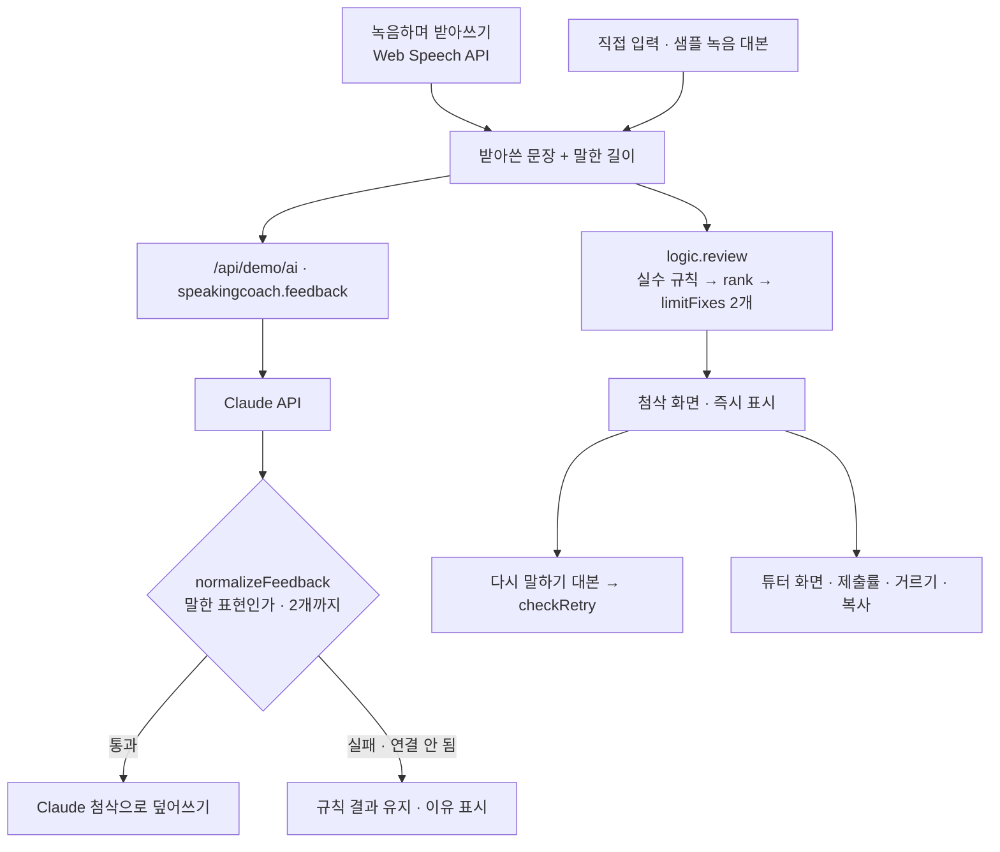

# 구조

## 고칠 점 2개를 고르는 법 (`rank` · `limitFixes`)

1. `findIssues()`가 문장마다 규칙 11개를 돌려 실수를 **규칙별로 묶는다** (같은 실수 여러 번 = 하나, `count`).
2. 지난 일 이야기(어제·지난주…)가 나오면 그 뒤 문장도 과거 맥락으로 본다. `I think`, `every`, `now`가 나오면 맥락을 끈다.
3. 줄 세우기: `weight`(3 뜻이 달라짐 · 2 문법 · 1 다듬기) → `count` → 처음 나온 위치.
4. 위의 `MAX_FIXES`(2)개만 학생에게, 나머지는 `later`(튜터만 보기).

## AI / 규칙 분기

| 단계 | 규칙 | Claude |
|---|---|---|
| 실수 찾기 | 패턴 11개 + um·uh 3번 이상 | 문맥으로 |
| 2개 제한 | `limitFixes` | 지시문 + `normalizeFeedback`이 한 번 더 자름 |
| 지어낸 지적 | 해당 없음 | `wrong`이 받아쓴 문장에 없으면 버림, 전부 그렇다면 응답 전체를 버림 |
| 다시 말하기 대본 | `applyFixes` | `retry` (없거나 너무 길면 `applyFixes`) |

## 파일

| 파일 | 하는 일 | DOM |
|---|---|---|
| `logic.js` | 실수 규칙, 우선순위, 2개 제한, 측정값, 응답 검사, 다시 말하기 확인, 제출률, 개인정보 가리기 | 없음 |
| `ai-client.js` | `/api/demo/ai` 호출, 실패하면 `null` | 없음 |
| `app.js` | 받아쓰기, 첨삭, 튜터 화면 | 있음 |
| `tests/logic.test.js` | `node --test` 12개 | — |
