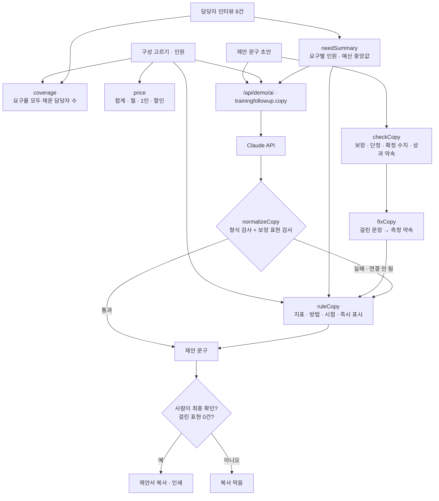

# 구조

## 문구 검사 (`checkCopy`)

| 종류 | 예 | 고치는 방법 |
|---|---|---|
| 결과를 보장하는 표현 | 효과를 보장합니다 | 측정 약속 문장으로 바꿈 |
| 재지 않는 성과를 약속함 | 팀 성과가 반드시 오릅니다 | 측정 약속 문장으로 바꿈 |
| 확정된 수치처럼 읽힘 | 만족도 100% | 측정 약속 문장으로 바꿈 |
| 단정 표현 | 반드시, 무조건, 확실히 | 그 낱말만 지움 |

- “효과를 보장하지 않습니다” 같은 부정문은 걸지 않습니다.
- 측정 약속 문장은 고른 구성의 지표를 차례로 씁니다(90일 리포트부터): “교육 후 90일에 역량 자가진단 점수 변화를 교육 전·90일 뒤 같은 설문 비교로 재서 보고합니다.”
- 검사기는 **후보를 표시**할 뿐 표시·광고 문구의 적법성을 판단하지 않습니다. 그래서 복사 전에 사람이 확인하는 체크를 둡니다.

## AI / 규칙 분기

- ‘제안 문구 만들기’를 누르면 규칙 문구가 **바로** 나오고, Claude 결과가 오면 덮어씁니다. 그 사이 다시 누르면 앞의 결과는 버립니다(`runToken`).
- 구성·인원을 바꾸면 규칙 문구만 다시 만듭니다(AI 호출 절약). 문구가 바뀌면 사람 확인 체크가 풀립니다.

## 파일

| 파일 | 하는 일 | DOM |
|---|---|---|
| `logic.js` | 인터뷰 요약, 요구 충족, 가격, 문구 검사·고치기, 조사 맞춤, 규칙 문구, 응답 검사, 제안서 | 없음 |
| `ai-client.js` | `/api/demo/ai` 호출, 실패하면 `null` (공통 파일, 수정 없음) | 없음 |
| `app.js` | 가상 인터뷰 8건, 구성·가격·문구 화면, 사람 확인, 복사·인쇄 | 있음 |
| `tests/logic.test.js` | `node --test` 12개 | — |
