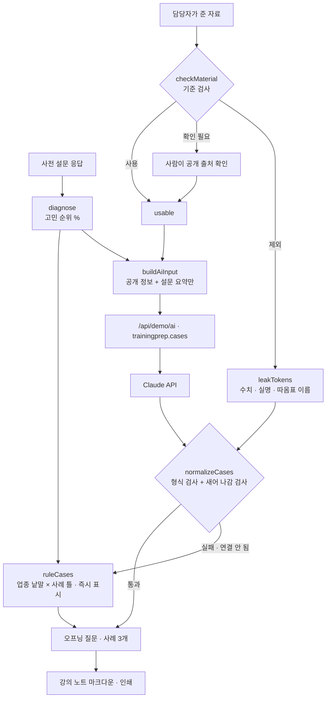

# 구조

## 입력 기준

| 판정 | 조건 | AI에 |
|---|---|---|
| 사용 | 출처가 공개 정보·설문 요약이고 아래에 걸리지 않음 | 넣음 |
| 확인 필요 | 금액·비율 수치(억, 원, %)가 있는 공개 자료 | 사람이 “공개 출처를 확인했어요”를 눌러야 넣음 |
| 제외 | 내부 자료로 표시 · 대외비/사내 한정 · 인사평가·연봉·면담 기록 · 직원 실명(성+이름+직함) · 연락처 | 넣지 않음 (확인을 눌러도) |

- 설문 요약의 비율은 우리가 낸 숫자이므로 확인 없이 사용합니다.
- ‘신임 팀장’, ‘현장 반장’처럼 직함 앞의 일반 낱말은 이름으로 보지 않습니다(성씨로 시작 + 예외 낱말 목록).
- 자유 응답 인용도 `cleanQuote`로 이름·연락처를 지운 뒤 60자까지만 보냅니다.

## AI / 규칙 분기

- 고객사를 고르거나 ‘사례 초안 만들기’를 누르면 규칙 사례가 **바로** 나오고, Claude 결과가 오면 덮어씁니다. 그 사이 고객사를 바꾸면 앞의 결과는 버립니다(`runToken`).
- Claude 사례 중 제외 자료의 낱말(띄어쓰기가 달라도)이 섞인 것은 버리고 ‘섞인 사례 n건 버림’ 배지를 보여 줍니다. 모두 버려지면 규칙 사례를 씁니다.

## 파일

| 파일 | 하는 일 | DOM |
|---|---|---|
| `logic.js` | 진단, 자료 기준 검사, 이름 찾기, 새어 나감 낱말, 업종 사례 틀(조사 맞춤), AI 입력, 응답 검사, 강의 노트 | 없음 |
| `ai-client.js` | `/api/demo/ai` 호출, 실패하면 `null` (공통 파일, 수정 없음) | 없음 |
| `app.js` | 가상 고객사 3곳, 진단·자료·사례 화면, 추가·지우기·복사·인쇄 | 있음 |
| `tests/logic.test.js` | `node --test` 11개 | — |
