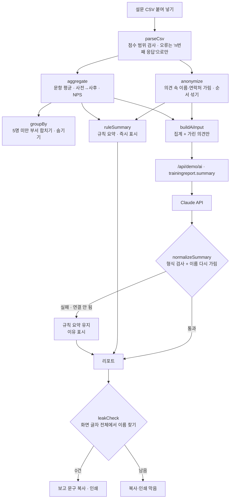

# 구조

## 익명 처리 세 겹

1. **표시** — 응답 표에도 이름 대신 응답 번호와 성 한 글자(`김○○`)만 보입니다. 이름은 CSV 안에서 중복 응답 확인용으로만 남습니다.
2. **가리기 (`maskText`)** — 응답자 명단으로 의견 속 `성+이름`, `이름+호칭`(도현 팀장님, 서연님), `성+직함`(김 팀장)을 `○○○`로, 전화·이메일을 `(연락처)`·`(이메일)`로 바꿉니다. 응답 순서로 짐작하지 못하게 의견 순서를 섞습니다(같은 입력이면 같은 순서).
3. **작은 집단 (`groupBy`)** — 응답 5명 미만 부서는 ‘기타’로 합치고, 합쳐도 5명 미만이면 부서 표에서 뺍니다(전체 집계에는 포함).

마지막으로 그린 리포트의 글자 전체를 `leakCheck`로 다시 훑어, 이름이 하나라도 남으면 배지를 빨갛게 바꾸고 복사·인쇄를 막습니다. Claude 응답도 `normalizeSummary`에서 한 번 더 가립니다.

## AI / 규칙 분기

- ‘리포트 만들기’를 누르면 규칙 요약이 **바로** 나오고, 요약 칸 위로 빛이 지나가는 동안 Claude를 기다립니다. 그 사이 다시 누르면 앞의 결과는 버립니다(`runToken`).
- 서버에 작업이 없거나(`알 수 없는 작업`) 키가 없으면 규칙 요약으로 끝나고, 이유가 배지에 표시됩니다.

## 파일

| 파일 | 하는 일 | DOM |
|---|---|---|
| `logic.js` | CSV, 익명 처리, 집계, 부서 묶기, 의견 주제, 규칙 요약, 응답 검사, 보고 문구 | 없음 |
| `ai-client.js` | `/api/demo/ai` 호출, 실패하면 `null` (공통 파일, 수정 없음) | 없음 |
| `app.js` | 예시 설문 생성, 응답 표, 리포트, 복사·인쇄·되돌리기 | 있음 |
| `tests/logic.test.js` | `node --test` 12개 | — |

## 실제 버전 (수료 프로젝트 계획)

| | 이 데모 | 실제 버전 |
|---|---|---|
| 설문 | CSV 붙여 넣기 | 자체 설문 폼 (이름은 별도 테이블, 리포트 쿼리에서 제외) |
| 저장 | localStorage | Supabase |
| 전달 | 복사 · 인쇄/PDF | 담당자용 공유 링크 |
