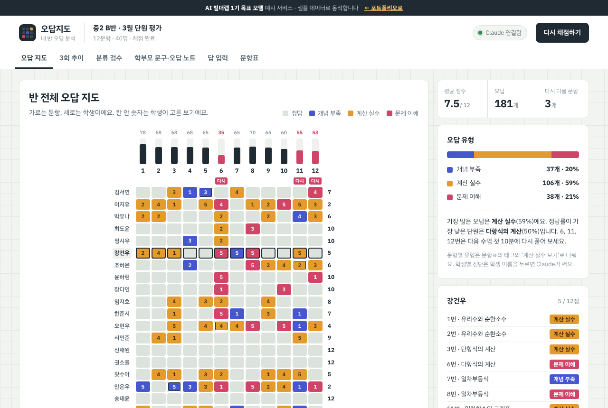

# 오답지도 — 내 반 오답 분석

> 학생이 고른 번호만 입력하면, 반 전체의 오답이 한 장의 **지도**로 칠해지고, 학생마다 Claude가 진단과 학부모 코멘트를 씁니다. 선생님은 그 결과를 검수해 **AI가 얼마나 맞았는지** 직접 잽니다.

   



**데모:** https://aibuilderlab.kr/demo/startup-wrong-answer/index.html

> 이 저장소는 **AI 빌더랩 창업 트랙 1기 ‘목표 모델’ 예시**입니다. 수료생이 이 수준까지 만든다는 목표를 보여 주려고 만들었고, 학생 이름은 모두 가상입니다. 데모는 샘플 데이터(40명 · 12문항)로 동작합니다.

## 문제 → 해결

| 문제 | 해결 |
|---|---|
| 학생 40명 시험지 채점과 학부모 카톡 리포트에 주 6시간이 걸렸습니다. | 고른 번호만 넣으면 채점 → 오답 지도 → 학생 진단 → 학부모 문구 → 인쇄용 오답 노트까지 한 번에. |
| 손글씨 풀이를 AI로 읽으면 오류가 많았습니다. | 풀이 대신 **학생이 고른 답**만 입력. 문항마다 단원·유형 태그와 ‘계산 실수 보기’를 붙여 유형을 판단합니다. |
| AI가 나눈 오답 유형을 믿어도 되는지 몰랐습니다. | 선생님이 한 건씩 검수하고 틀리면 진짜 유형을 고릅니다. **규칙 분류 일치율**과 **Claude 진단 일치율**을 따로 잽니다. |

## 주요 기능

- **오답 지도** — ‘채점하기’를 누르면 문항 한 줄씩 색이 칠해지고 정답률 막대가 올라옵니다. 60% 아래 문항에는 ‘다시’. 문항을 누르면 보기 분포, 학생을 누르면 오답 목록과 **Claude 진단**.
- **Claude 학생 진단** — 오답 목록(선생님이 고친 유형 포함)을 읽고 가장 큰 오답 유형, 학부모용 2문장 코멘트, 다음 수업 처방을 씁니다. 옆에 `Claude로 분석 · 1.2초` 또는 `규칙 기반 · 이유`.
- **3회 추이** — 1월 진단 → 2월 단원 → 이번 평가의 반 평균, 오답 유형 비율 변화, 많이 오른 학생과 살펴볼 학생(누르면 지도에서 그 학생).
- **분류 검수** — 한 번에 한 건. `Y` 맞음 · `N` 틀림 → `1` `2`로 진짜 유형 · `S` 건너뛰기 · `Z` 취소. 반원 게이지(샘플 기준 약 94%)와 Claude 진단 일치율.
- **학부모 문구 · 오답 노트** — 알림장 모양 문구(진단·처방 포함) 복사, 학생 한 명 또는 반 전체를 A4로 인쇄(학생마다 한 장, ‘다시 풀기’ 칸과 확인란).
- **답 입력** — 엑셀처럼 화살표로 이동, 1~5가 아니면 칸이 흔들리며 막음. 엑셀·메모에서 **한꺼번에 붙여 넣기**(공백·쉼표·탭·붙여 쓴 숫자 모두).
- **문항표** — 단원·유형 태그·정답·계산 실수 보기. 정답과 계산 실수 보기가 같으면 저장하지 않습니다.

### 오답 유형 판단 규칙 (문항 단위, `logic.js`)

1. 정답이면 통과
2. ‘계산 실수 보기’를 골랐으면 **계산 실수**
3. 아니면 문항 태그로: 개념형 → **개념 부족**, 계산형 → **계산 실수**, 서술·활용형 → **문제 이해**

문항 단위는 결과가 늘 같아야 검수할 수 있어서 규칙으로, 학생 단위 진단은 문장을 써야 해서 Claude로 나눴습니다. Claude에 연결할 수 없으면 규칙 코칭으로 바뀌고 화면에 이유가 표시됩니다.

## 기술 스택

| | 이 데모 | 실제 버전 (포트폴리오 기준) |
|---|---|---|
| 화면 | HTML · CSS · JavaScript (빌드 도구 없음) | Next.js |
| 데이터 | 브라우저 localStorage | Supabase |
| AI | Claude API (서버 경유) + 규칙 대체 | Claude API |
| 출력 | 문구 복사 · 인쇄(`@media print`) | 다음주 리포트와 연결 |

그래프·히트맵·게이지는 라이브러리 없이 HTML·SVG로 그립니다. 글꼴은 IBM Plex Sans KR 하나.

자세한 구조: [docs/ARCHITECTURE.md](docs/ARCHITECTURE.md)

## 폴더 구조

```
startup-wrong-answer/
├── index.html        탭 6개 + 인쇄 영역
├── style.css         모눈종이 · 유형 3색 · 인쇄용 A4
├── app.js            화면 그리기 · 검수 키보드 · 인쇄
├── logic.js          순수 함수: 채점, 유형, 통계, 일치율, 코칭 검사, 문구, 추이, 붙여 넣기
├── ai-client.js      Claude 호출기 (실패하면 null → 규칙으로)
├── tests/
│   └── logic.test.js   node:test 15개
├── docs/
│   ├── DEVLOG.md       4~6주차 개발 일지
│   ├── PROMPTS.md      AI 활용 기록
│   └── ARCHITECTURE.md
├── CHANGELOG.md
└── screenshot.png
```

## 실행 · 테스트

```bash
python3 -m http.server 8000      # → http://localhost:8000
npm test                         # Node 18 이상, 설치할 패키지 없음
```

입력한 내용은 이 브라우저에만 저장됩니다. 아래 ‘샘플 데이터로 되돌리기’로 처음 상태로 돌아갈 수 있어요.

## AI 활용 기록 (COVI 요약)

| 프롬프트 | 디버깅 | 걸린 시간 | 해결한 문제 |
|---:|---:|---:|---|
| 39 | 7 | 9시간 | 손글씨 풀이 인식 오류 → 학생 답만 입력, 문항별 태그로 유형 판단 |

결과(목표치): 리포트 6시간 → 20분, 분류 일치율 94%. 주차별 기록은 [docs/DEVLOG.md](docs/DEVLOG.md), 지시문은 [docs/PROMPTS.md](docs/PROMPTS.md).

> 리드 빌더 코멘트 — “AI 결과를 직접 검수해서 일치율을 잰 게 이 프로젝트의 핵심입니다.” — 린스타터

---

AI 빌더랩 창업 트랙 · 린스타터 목표 모델 · MIT License
