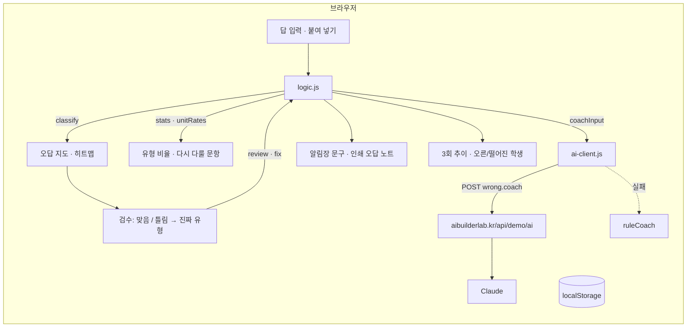

# 오답지도 · 구조

- **logic.js** — 채점, 유형 판단, 반 통계, 일치율(문항·학생 두 가지), 코칭 입력·검사, 학부모 문구, 지난 점수, 붙여 넣기 파싱. `npm test`로 15개 검사.
- **app.js** — 탭 6개(오답 지도·3회 추이·분류 검수·학부모 문구·답 입력·문항표)와 인쇄 영역.
- **선생님이 고친 유형**은 지도·문구·Claude 입력에 모두 반영됩니다(`labelsOf`).

## 실제 버전 (수료 프로젝트 계획)

| | 이 데모 | 실제 버전 |
|---|---|---|
| 입력 | 표에 번호 입력 · 붙여 넣기 | OMR·태블릿 입력, 시험마다 기록 저장 |
| 저장 | localStorage | Supabase (반·시험·문항·답안 테이블) |
| 학생 진단 | Claude(서버 경유) / 규칙 | Claude API + 누적 오답 패턴 |
| 학부모 전달 | 문구 복사 · 인쇄 | 다음주 리포트와 연결 (프로젝트 3) |
